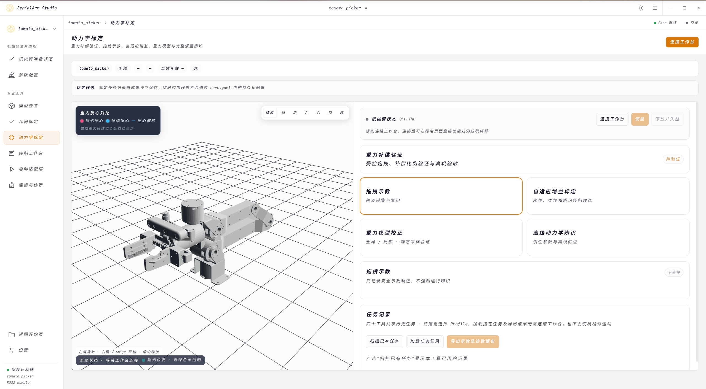
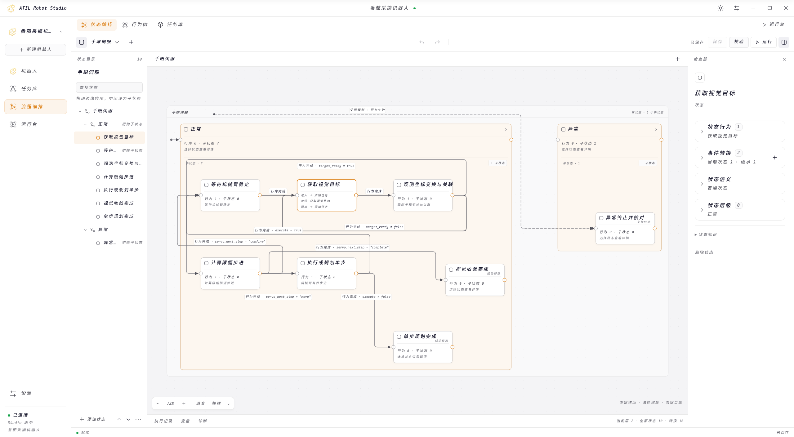

<!-- visual-profile-v2 -->

<a href="README_zh.md">中文</a> · <strong>English</strong>

  
  
  

<strong>🤖 Robotics Developer</strong> 🎓 SCAU Undergraduate &nbsp; · &nbsp; 🌱 AgroTech-SCAU Lead

  
  
  

## 👋 About Me

I develop robotic-arm software, embedded control systems, and robot integration frameworks, with hands-on work in agricultural robotics and real hardware. My work spans models, drivers, and control through calibration, task orchestration, and deployment.

I aim to turn implementations for individual robots into general-purpose cores, portable modules, and reusable interfaces that future projects can build on.

## 🚀 Featured Work

These projects pursue **general-purpose architectures, portability, and reuse across robot projects**. They span my personal and AgroTech-SCAU repositories, where I lead development or contribute as a primary code author.

<table>
<tr>
<td width="50%" valign="top">
<h3><a href="https://github.com/Kaede-Rei/SerialArm-Core">🦾 SerialArm-Core</a></h3>

 

Building a general-purpose, extensible C++17 dynamics core for serial manipulators, separating rigid-body dynamics, gravity compensation, and calibration from specific robot models, actuator backends, and upper-level frameworks.

Robot profiles and shared hardware interfaces support adaptation to different arms, with impedance/admittance control, Python bindings, and ROS 2 / ros2_control / MoveIt 2 integration. SerialArm Studio provides model, calibration, control, and diagnostic workflows. Linux packages are available in <a href="https://github.com/Kaede-Rei/SerialArm-Core/releases">Releases</a>.

</td>
<td width="50%" valign="top">
<h3><a href="https://github.com/AgroTech-SCAU/Competition-Robot-2026-Atlas">🤖 Atlas</a></h3>

 

An embedded software baseline already iterated and reused across multiple wheeled competition robots, with continued work on portability and adaptation through configuration. It covers <strong>swerve-drive chassis control, five-axis arm motion control, RC receiver integration, and leader–follower teleoperation</strong>.

My work refines reusable boundaries around MCU drivers, communication, kinematics, scheduling, state machines, control authority, and faults to support different robot configurations. I also implemented the YASMIN mission state machine.

Atlas is retained as an archived baseline, with code carried forward into <a href="https://github.com/AgroTech-SCAU/Competition-Robot-2026-Longinus">Longinus</a> and related Competition-Robot-2026 projects.

</td>
</tr>
<tr>
<td width="50%" valign="top">
<h3><a href="https://github.com/AgroTech-SCAU/Embedded-Electronic-Control-Standard">⚙️ Embedded Control SDK</a></h3>

 

A shared MCU SDK developed with portability across projects and MCU platforms as a design goal, separating drivers, utilities, and kinematics from specific HALs, boards, and application logic.

Platform interfaces, project-side assembly, and layered boundaries let new devices and boards connect through adapters, while shared conventions cover timeouts, stops, and fault handling.

</td>
<td width="50%" valign="top">
<h3><a href="https://github.com/AgroTech-SCAU/AT-System-Integration">🧩 AT-System-Integration</a></h3>

 

Building a general-purpose integration framework for different robots and tasks. Shared capability interfaces and adapters connect manipulation, vision, navigation, and embedded backends, reducing task logic's dependence on any single project's implementation.

ATIL Robot Studio provides visual state orchestration, behavior-tree task design, and runtime diagnostics. Under active development, with capability-level mocks and an existing behavior-tree execution path; hardware integration progresses through project-specific validation.

</td>
</tr>
</table>

## 🖥️ Tools in Action

<table>
<tr><th width="50%"><a href="https://github.com/Kaede-Rei/SerialArm-Core">🦾 SerialArm Studio</a></th><th width="50%"><a href="https://github.com/AgroTech-SCAU/AT-System-Integration">🧩 ATIL Robot Studio</a></th></tr>
<tr><td></td><td></td></tr>
<tr><td align="center">Calibration and validation workbench for the dynamics core</td><td align="center">AT-System-Integration · Visual state and task orchestration</td></tr>
</table>

📐 Handeye Calibration Workbench

## 🗺️ Project Map

Other representative projects where I lead development or contribute as a primary code author.

| Project | Focus & Main Contributions |
| --- | --- |
| 📐 [Handeye-Calibration-App](https://github.com/AgroTech-SCAU/Handeye-Calibration-App) | Visual hand–eye calibration: camera/robot inputs, synchronized sampling, solver diagnostics, and independent geometric validation |
| 🍅 [Tomato-Manipulation](https://github.com/AgroTech-SCAU/Tomato-Manipulation) | Tomato-picking application built on SerialArm-Core: MoveIt 2 motion capabilities, end-effector control, RGB-D / Planning Scene integration, and picking tasks |
| 🧠 [Dual-DM-Arm-LeRobot](https://github.com/Kaede-Rei/Dual-DM-Arm-LeRobot) | Dual-arm teleoperation, demonstration collection and processing, LeRobot hardware integration, imitation learning, and policy deployment experiments |
| 🍃 [Tea-Picking-Dual-Arm](https://github.com/AgroTech-SCAU/Tea-Picking-Dual-Arm) | HX-10HM / RM65-B leader–follower systems: joint mapping, homing, gravity-compensation integration, and single-/dual-arm teleoperation |
| ⚙️ [Wheel-Rail-Integrated-Chassis](https://github.com/AgroTech-SCAU/Wheel-Rail-Integrated-Chassis) | STM32H723 chassis control: four-wheel steering kinematics, motor communication, remote-control inputs, scheduling, and fault handling |

## 🧰 Technical Stacks

  
  
  

  
  
  
  
  
  

  
  
  
  
  

- **🦾 Robotic arms:** kinematics and rigid-body dynamics (Pinocchio), model and dynamics calibration, joint control and gravity compensation, ROS 2 / MoveIt 2, hand–eye calibration, and RGB-D integration; exploring teleoperation, demonstrations, and imitation learning
- **⚙️ Embedded software:** STM32, CAN / UART / SPI, actuator and IMU interfaces, swerve-drive and five-axis arm control, RC inputs and teleoperation, IMU/odometry processing, local pose estimation, PID, hierarchical state machines, control authority, timeouts, and faults
- **🧩 System integration:** Linux and ROS 2, MCU–host communication, coordinate frames and interface contracts, task state machines and behavior trees, configuration, diagnostics, and deployment

## 🌱 AgroTech-SCAU

As one of the association's leads, I combine hands-on development with technical coordination: project architecture, shared infrastructure, module interfaces, integration and debugging, engineering standards, documentation, and technical guidance.

I also study mechanics, computer vision, and mobile navigation to support system-level decisions and collaboration across the team. My main development focus remains robotic arms, embedded software, and system integration.

🗃️ Earlier Work & Learning

- [Renesas-DM-Arm](https://github.com/Kaede-Rei/Renesas-DM-Arm): earlier MCU arm kinematics, CAN motor control, and state-machine work
- [DM-Arm-MoveIt2](https://github.com/Kaede-Rei/DM-Arm-MoveIt2): MoveIt 2 integration and arm motion-planning experiments
- [Hand-Eye-GUI-Tools](https://github.com/Kaede-Rei/Hand-Eye-GUI-Tools): ROS Noetic hand–eye and multi-camera extrinsic calibration tools
- [Modern-Robotics-Curriculum](https://github.com/Kaede-Rei/Modern-Robotics-Curriculum): AI-assisted personal robotics study materials and teaching experiments

## 📊 Development Activity

<table width="100%">
<tr>
<td width="50%" valign="top">
<picture>
  <source media="(prefers-color-scheme: dark)" srcset="https://github-stats-extended.vercel.app/api?username=Kaede-Rei&amp;show_icons=true&amp;rank_icon=github&amp;role=OWNER%2CORGANIZATION_MEMBER%2CCOLLABORATOR&amp;include_all_commits=true&amp;hide=contribs&amp;show=contributions&amp;line_height=20&amp;card_width=450&amp;custom_title=Development%20Stats&amp;bg_color=0D1117&amp;title_color=C4B5FD&amp;text_color=C9D1D9&amp;icon_color=2DD4BF&amp;border_color=30363D" />
  
</picture>
</td>
<td width="50%" valign="top">
<picture>
  <source media="(prefers-color-scheme: dark)" srcset="https://github-stats-extended.vercel.app/api/top-langs/?username=Kaede-Rei&amp;layout=compact&amp;langs_count=6&amp;card_width=450&amp;custom_title=Public%20Repo%20Languages&amp;bg_color=0D1117&amp;title_color=C4B5FD&amp;text_color=C9D1D9&amp;icon_color=2DD4BF&amp;border_color=30363D" />
  
</picture>
</td>
</tr>
</table>

<picture>
  <source media="(prefers-color-scheme: dark)" srcset="https://github-profile-summary-cards.vercel.app/api/cards/profile-details?username=Kaede-Rei&amp;theme=github_dark" />
  
</picture>

## 📫 Get in Touch

  
  
  

<a href="mailto:kaerei@foxmail.com">Alternative: kaerei@foxmail.com</a>

